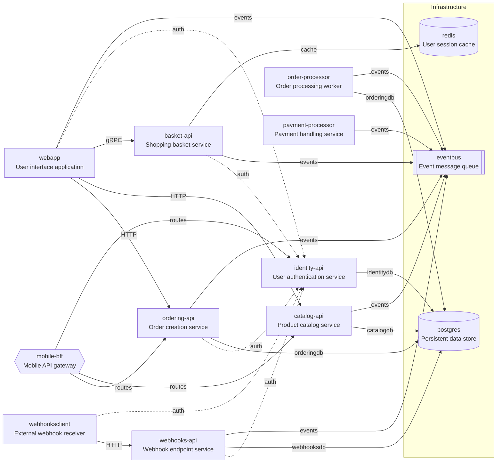

# Components

Generated by `dev_docs` from `src/eShop.AppHost`, the project files and the HTTP/gRPC client registrations. Change the code, not this file. Solid arrow = calls / uses, dotted = gets a URL (auth).

| Box | What it is | Where | Talks to | Uses libraries |
|---|---|---|---|---|
| redis | User session cache | Redis | — | — |
| eventbus | Event message queue | RabbitMQ | — | — |
| postgres | Persistent data store | Postgres | — | — |
| identity-api | User authentication service | `src/Identity.API` | postgres (identitydb) | eShop.ServiceDefaults |
| basket-api | Shopping basket service | `src/Basket.API` | redis (cache), eventbus (events), identity-api (auth) | EventBusRabbitMQ, eShop.ServiceDefaults |
| catalog-api | Product catalog service | `src/Catalog.API` | eventbus (events), postgres (catalogdb) | EventBusRabbitMQ, IntegrationEventLogEF, eShop.ServiceDefaults |
| ordering-api | Order creation service | `src/Ordering.API` | eventbus (events), postgres (orderingdb), identity-api (auth) | EventBusRabbitMQ, IntegrationEventLogEF, Ordering.Domain, Ordering.Infrastructure, eShop.ServiceDefaults |
| order-processor | Order processing worker | `src/OrderProcessor` | eventbus (events), postgres (orderingdb) | EventBusRabbitMQ, eShop.ServiceDefaults |
| payment-processor | Payment handling service | `src/PaymentProcessor` | eventbus (events) | EventBusRabbitMQ, eShop.ServiceDefaults |
| webhooks-api | Webhook endpoint service | `src/Webhooks.API` | eventbus (events), postgres (webhooksdb), identity-api (auth) | EventBusRabbitMQ, IntegrationEventLogEF, eShop.ServiceDefaults |
| mobile-bff | Mobile API gateway | Yarp | identity-api (routes), catalog-api (routes), ordering-api (routes) | — |
| webhooksclient | External webhook receiver | `src/WebhookClient` | identity-api (auth), webhooks-api (HTTP) | eShop.ServiceDefaults |
| webapp | User interface application | `src/WebApp` | eventbus (events), identity-api (auth), basket-api (gRPC), catalog-api (HTTP), ordering-api (HTTP) | EventBusRabbitMQ, WebAppComponents, eShop.ServiceDefaults |
